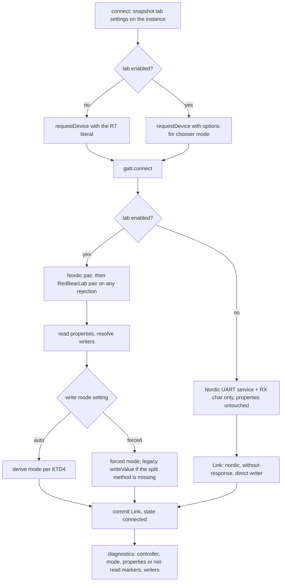
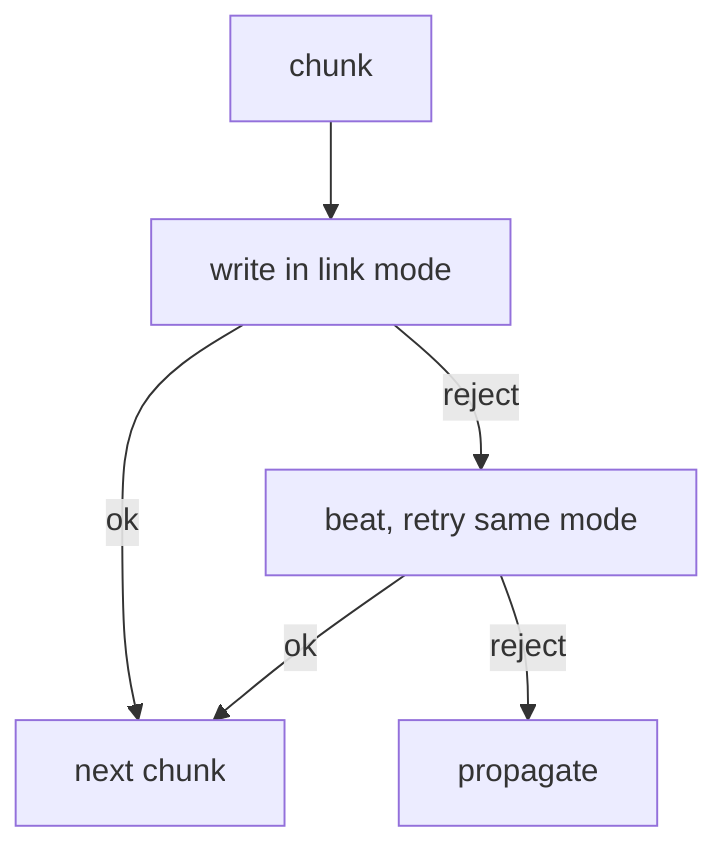
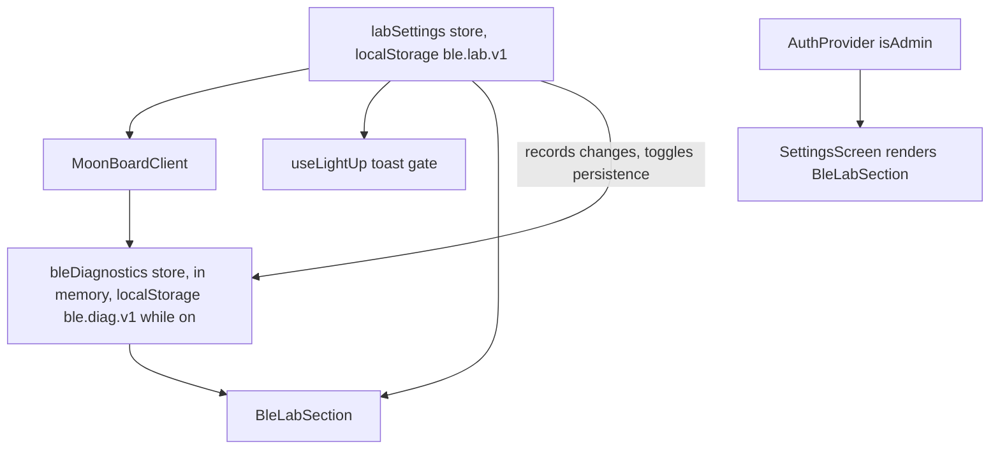

# Admin-Only BLE Lab for Older MoonBoard LED Boxes - Plan

## Goal Capsule

- **Objective:** Give the owner an admin-only "BLE lab" in the web PWA Settings that switches the Web Bluetooth client onto an experimental path (both MoonBoard controller generations, write type chosen from the characteristic's properties, in-app diagnostics), while every device with the lab off keeps today's Bluetooth behaviour byte for byte, except the bounded echoed-disconnect reconnect of R25.
- **Authority:** The Product Contract below is fixed; the user confirmed scope and the four call-outs on 2026-10-26 (JWT claim for admin, lab-only toasts, an "any device" picker mode). `AGENTS.md` tier rules apply: `web/src/ble/**` and `shared/spec/ble-protocol.md` are safety-critical, so work is test-first, review before merge is mandatory, and a `docs/solutions/` entry follows the hardware check (not this PR). `docs/ble-hardware.md` invariants 1 to 5 must survive unchanged. The 2026-09-30 plan (`docs/plans/2026-09-30-001-feat-web-redbearlab-led-box-plan.md`) is the source for the experimental client logic; its implementation (PR #165) was reverted by PR #167 after it broke lighting on the owner's phone for both boards, so nothing from it may run unless the lab is on.
- **Tier:** Safety-critical. Effort max.
- **Execution profile:** Implement on branch `feat/web-ble-lab` in the worktree `.claude/worktrees/feat-web-ble-lab` (its `web/.env` is already copied, dependencies installed, baseline `npx vitest run` green at 1172 tests). Unit tests prove every unit before its code; the owner proves the lab-off path on the DIY board from a preview deployment before anything reaches production.
- **Stop conditions:** Stop and report if the lab-off path would change in any observable way beyond R25 (chooser options, GATT calls, property or id reads, write method, retry count, error text, storage writes), if the shared BLE state shape consumed by the UI (`state`, `deviceName`, `error`) or the `useBle` export set would have to change, if admin detection would need a database migration, or if a Bluefy behaviour can only be settled by a hardware test (record it as a lab diagnostic instead of guessing). A dark DIY board with the lab on is a lab finding to capture, not a stop condition.
- **Tail ownership:** The owner grants the admin claim with one SQL statement, opens a preview deployment of the merged branch in Bluefy and confirms the lab-off path lights the DIY board, promotes to production, then runs the lab-on steps in the Verification Contract on the DIY board and at a gym, and pastes the copied diagnostics back. A `docs/solutions/` entry and the hardware-verified wording in the spec follow that check.

---

## Product Contract

### Summary

Settings gains a "BLE lab" card that only admins see. The card holds a master switch for an experimental Bluetooth path, a device-picker mode, a write-mode override, quick actions (connect, light one LED, clear, disconnect), and a log of what the last connections did, with Copy, Show as text, and Clear. Admin means the signed-in user's Supabase token carries `app_metadata.role = "admin"`, which the owner sets once in the Supabase SQL editor. The lab settings live on the device. When the lab is on, the client finds both the Nordic UART boards and the original RedBearLab box, probes Nordic then RedBearLab after connecting, and writes with acknowledgement when the box lacks write-without-response, or when the owner forces a mode. When the lab is off, the client runs today's code path; a device runs the lab path only while its stored lab flag is on, which only the admin card or a manual edit can set. Connect failures are toasted on the problem screens only while the lab is on. Every connection records diagnostics in memory; they are persisted and shown only through the lab.

### Problem Frame

At several gyms with older official MoonBoard LED systems the PWA connects but no LED lights, while the owner's DIY Nordic board works. The client always writes without response. On Apple stacks (Bluefy on iPhone, Chrome on macOS) that write is handed to CoreBluetooth and reported as a success even when the characteristic only permits acknowledged writes; CoreBluetooth drops it with a log line. The original RedBearLab box (`713d0003`) advertises plain write only, and other official boxes may too. The reverted PR #165 fixed this for everyone at once and broke the owner's phone for both boards; the root cause was never found because nothing in the app showed what the Bluetooth stack did. A connect failure is also invisible today: `connectBoard()` in `web/src/ble/useBle.ts` swallows it into a state only the unrouted `BuildScreen.tsx` reads. The owner now has real users and needs to test the fix on their own account without changing anyone else's experience.

### Requirements

**Admin gate**

- R1. A signed-in user whose Supabase session user has `app_metadata.role === 'admin'` is an admin; everyone else, including signed-out visitors, users with any other role value, and users with `user_metadata.role === 'admin'`, is not.
- R2. The auth context exposes `isAdmin`, recomputed on every auth event from the session it receives, and a pure helper `isAdminUser(user)` carries the rule so it can be tested without a provider.
- R3. No database migration, table, or policy is added for the role; granting it is one SQL statement the owner runs in the Supabase dashboard, documented in `docs/social-accounts-login-SETUP.md` with the note that the claim lands on the next sign-in or token refresh (within the hour), and that signing out and in is the deterministic way.

**Lab settings (device-local)**

- R4. Lab settings persist in localStorage under one key and expose `enabled` (default off), `chooser` (`nordic` default, `both`, `any`), and `writeMode` (`auto` default, `with-response`, `without-response`).
- R5. Unknown or corrupt stored values fall back to the defaults per field; a missing or throwing localStorage leaves the store working in memory for the page session, so the lab can still be switched on there.
- R6. The Bluetooth client reads the settings once per connect attempt, keeps that snapshot for the attempt's reconnects, and never reads auth state. A device with a stale `enabled` flag therefore runs the lab path even when signed out, which is acceptable because the flag can only be set through the admin UI or by hand and grants nothing beyond local Bluetooth behaviour.

**Default path invariance**

- R7. With the lab off, the chooser request is exactly `{ filters: [{ services: [NUS_SERVICE] }] }`, only the Nordic UART service and RX characteristic are looked up, the characteristic's `properties` and the device's `id` are never read, and chunks go out through `writeValueWithoutResponse` with the existing single same-mode retry; the 22 existing client tests pass unchanged.
- R8. With the lab off, no toast is added on any screen outside the admin card and no localStorage key is written by the Bluetooth path; the only additions to the shared path are in-memory diagnostics recording (R18) and the bounded reconnect of R25.

**Experimental path (lab on)**

- R9. The chooser request follows `chooser`: `nordic` is the R7 literal; `both` lists the Nordic UART service, the RedBearLab service, and the `MoonBoard` name prefix as three OR'd filters with both services in `optionalServices`; `any` sets `acceptAllDevices` with both services in `optionalServices` and no `filters` key. The options object is built fresh for every call and never frozen.
- R10. After GATT connect the client resolves the Nordic UART pair first and, on any rejection, the RedBearLab pair; it records which controller matched. Both absent, or both rejecting namelessly, fails connect with the readable "no known MoonBoard LED service" message and severs the link; a named failure such as `NetworkError` or `SecurityError` surfaces as itself. The reduced race guard before the second lookup checks only user-disconnect and device identity.
- R11. Write mode `auto`: a Nordic link writes without response unless its properties report only plain write; a RedBearLab link writes with response unless its properties report write-without-response only; a RedBearLab link with absent or empty properties writes with response. Every link's mode is fixed for its lifetime; there is no automatic flip, because the owner's override (R12) covers the case the flip was designed for.
- R12. Write mode `with-response` or `without-response` forces that mode for the link, with the normal single same-mode retry; when the characteristic lacks the split method for the forced mode the legacy `writeValue` stands in and the link records its writer as `legacy` (the browser then chooses the ATT write type, so the mode is not truly forced and the card says so), and when no method exists sends fail with a readable message naming the missing write method.
- R13. The client exposes `lightLed(index)` which writes the single-LED calibration message `l#P<index>#` through the shared write path.
- R14. Message building, ASCII encoding, the 20-byte chunk cap, sequential awaits, the connect timeout, the retained-device reconnect, and the user-disconnect invariant are unchanged on both paths. A reconnect re-runs the probe and re-derives the write mode from the new characteristic. A live link never changes mode.

**Diagnostics**

- R15. A diagnostics store keeps the newest 100 timestamped events in memory as its source of truth, exposes a hook, `clear`, a reset for tests, and a plain-text export. Events carry Bluetooth facts only (times, UUIDs, names, properties, modes, byte counts, raw errors), never problem names or user ids.
- R16. The client records: connect start with the lab settings and chooser mode in effect; the chosen device's name (the value the client already reads) and, on the lab-on path only, the first eight characters of its id; GATT connected; each service and characteristic lookup with its outcome, and on failure the rejection's `name`, `code`, `message`, `typeof`, and `String(err)`; on the lab-on path the characteristic's properties (`write`, `writeWithoutResponse`, `notify`, and whether `properties` was absent) and which write methods exist, and on the lab-off path the markers `properties: not read` and `writers: not probed`; the write mode chosen, whether it was forced, and whether the writer is `legacy`; each send with message length, chunk count, mode, writer, duration, and outcome; each chunk retry; disconnects as user or link; reconnect attempts; and on a connect timeout, which step was pending. A failed connect is recorded once, by the client.
- R17. The lab settings store records every settings change as a diagnostics event and turns diagnostics persistence on while `enabled` is true and off otherwise.
- R18. While persistence is on, events are mirrored to one localStorage key inside try/catch; turning persistence on loads the stored events only when the in-memory buffer is empty, and otherwise keeps the buffer and overwrites the key with it, so a lab-off control run recorded in memory survives switching the lab on. While off, nothing is written. Recording never throws into the caller, never awaits, and never changes the order or count of Bluetooth calls; any property read made only to feed a record happens inside the recorder's try/catch.

**Connect failures**

- R19. `connectBoard()` keeps its state contract and the `useBle` export set, and resolves to `null` on success or to `{ message, raw }` on failure, where `message` is the normalized text and `raw` is the Error's own message or `String(err)` for a non-Error rejection.
- R20. `useLightUp` toasts a connect failure only while the lab is on, with `message` followed by ` [raw]` when `raw` differs from `message`; every rejection is toasted in lab mode, including a chooser cancel, because learning what Bluefy rejects a cancel with is part of the diagnostic. With the lab off, behaviour is exactly today's (no toast). `useLightUp` reads the lab flag from the lab settings module, not through `useBle`, and tolerates a mocked `connectBoard` that resolves to `undefined`.

**Settings UI**

- R21. `SettingsScreen` renders a `BleLabSection` card only when `isAdmin` is true; non-admins and signed-out users never see it, and no other screen reads the lab storage keys.
- R22. The card shows: a Switch for `enabled`; two three-way ToggleGroups for `chooser` and `writeMode`, each with an accessible group name and a one-line helper explaining the options (the picker helper states that the log can only show the two known services, so an unknown box needs an nRF Connect capture), disabled while the lab is off; a status block with connection state, device name, controller, write mode (reading "forced (legacy writeValue, type chosen by the browser)" when the writer is `legacy`), the properties snapshot, and the last quick action's result; quick actions Connect, Light LED 0, Clear LEDs, and Disconnect; the event list newest first in small monospace inside a fixed max-height scroll container with wrapping, and a one-line empty state; Copy diagnostics (clipboard, toast on success or failure); Show as text (a read-only textarea with the export, with `aria-expanded` on its button); Clear log behind a confirm step, placed apart from Copy. All copy says the path is experimental.
- R23. Changing any lab setting first calls the user-style disconnect unconditionally (a no-op without a device; with one, the next tap opens the chooser) and the card says so. Quick actions work with the lab on or off (with it off they exercise today's path, which is the owner's control run) and toast their failures through the existing error normalization; Connect is disabled while connecting, Light LED 0 and Clear LEDs are disabled unless connected and idle.

**Documentation**

- R24. `docs/ble-hardware.md` describes the lab, the diagnostics, the write-type rule, the bounded reconnect, and why the default path is untouched; `shared/spec/ble-protocol.md` documents the second controller generation's UUIDs and the write-type rule, marked unverified on hardware and reachable only through the lab; `docs/social-accounts-login-SETUP.md` documents the admin claim with a merge-form grant, a revoke statement, and a placeholder email; `docs/navigation-and-ui-flows.md` gains the Settings route line and a "BLE lab" store blurb.

**Shared fix**

- R25. A `gattserverdisconnected` event that arrives while the client is not in the `connected` state (Chrome echoes the client's own `gatt.disconnect()` after a failed lookup, a timeout, or a guard bail) does not reset the reconnect backoff counter; only a drop from `connected` does. This applies on both paths and bounds an auto-reconnect whose lookups keep failing to the existing four attempts.

### Acceptance Examples

- AE1. **Lab off is today's client.** Given the lab settings are at their defaults and the characteristic exposes only `writeValueWithoutResponse` (today's test fake), when a user connects and lights a problem, then `requestDevice` was called once with an object deep-equal to `{ filters: [{ services: [NUS_SERVICE] }] }`, `getPrimaryService` only with the Nordic UART UUID, `getCharacteristic` only with the RX UUID, the characteristic's `properties` getter and the device's `id` getter were never touched, every chunk went through `writeValueWithoutResponse`, and no localStorage key was written.
- AE2. **Lab off swallows a connect failure silently.** Given the lab is off and `requestDevice` rejects, when the user taps Light up, then no toast is shown, the button returns to idle, and the in-memory diagnostics hold the rejection with its name and message.
- AE3. **Lab on toasts the same failure.** Given the lab is on and `requestDevice` rejects with a bare numeric `2`, when the user taps Light up, then a toast shows the friendly fallback text followed by `[2]`; given it rejects with `new Error('Bluetooth adapter is off')`, the toast shows that text with no suffix.
- AE4. **Both-generations chooser.** Given the lab is on with chooser `both`, when the user taps Connect, then `requestDevice` receives three filters (Nordic service, RedBearLab service, `MoonBoard` name prefix) and both services in `optionalServices`, as a fresh, unfrozen object.
- AE5. **Any-device chooser.** Given chooser `any`, when the user taps Connect, then `requestDevice` receives `acceptAllDevices: true` and both services in `optionalServices`, and no `filters` key.
- AE6. **Original box in auto mode.** Given the lab is on, chooser `both`, write mode `auto`, and the device exposes only the RedBearLab service whose characteristic reports `write: true, writeWithoutResponse: false`, when a 45-byte problem is sent, then three chunks of 20, 20, and 5 bytes go through `writeValueWithResponse` in order and nothing goes through `writeValueWithoutResponse`; the diagnostics show controller `redbearlab`, mode `with-response`, and the properties.
- AE7. **Nordic board stays without response in auto mode.** Given the lab is on in its default chooser and write mode and a Nordic board whose properties report `writeWithoutResponse: true`, when a problem is sent, then every chunk goes through `writeValueWithoutResponse`, as with the lab off.
- AE8. **Forced acknowledged writes on a Nordic board.** Given the lab is on with write mode `with-response` and a Nordic board, when a problem is sent, then every chunk goes through `writeValueWithResponse`; a rejection is retried once in the same mode and then propagates as a toast; the mode never changes.
- AE9. **Forced mode without a method.** Given write mode `with-response` and a characteristic that exposes only `writeValueWithoutResponse`, when a problem is sent, then the send rejects with a readable message naming the acknowledged write method and no write is attempted.
- AE10. **Settings change disconnects first.** Given a connected Nordic link, when the owner switches write mode in the card, then the fake `gatt.disconnect` is called before the store changes, the state returns to disconnected, the next Connect opens the chooser, and sends after that connect use the new mode.
- AE11. **Admin gate.** Given `useAuth` reports `isAdmin: true`, when Settings renders, then the BLE lab card is present; given `isAdmin: false`, the card is absent. Given a session user with `app_metadata: { role: 'admin' }`, `isAdminUser` is true; given `role: 'editor'`, no `app_metadata`, `user_metadata: { role: 'admin' }`, or no user, it is false.
- AE12. **Copy diagnostics.** Given three recorded events, when the owner taps Copy diagnostics, then the clipboard receives a text block containing the lab settings, the link summary, and the three events in chronological order, and a success toast shows; when the clipboard write rejects, a failure toast shows and Show as text reveals the same block.
- AE13. **Diagnostics stay capped and survive a reload while the lab is on.** Given the lab is on and 120 events were recorded, when the page reloads, then the store holds the newest 100 in order; given localStorage throws, recording still works in memory and nothing is thrown to the caller; given the lab is off, no key is written. Given three events were recorded with the lab off, when the owner switches the lab on, then the three events are still in the store and are now written to the key.
- AE14. **Echoed disconnect does not loop the auto-reconnect.** Given a connected board with the lab on whose link drops and whose Nordic and RedBearLab lookups then reject, with the fake echoing the client's own `gatt.disconnect()` as a disconnect event, when the backoff runs, then `gatt.connect` is called at most four more times (five in total), the state stays `disconnected`, and no further call happens after 60 seconds of fake time. Given the lab is off and the Nordic lookup hangs after a drop, the connect timeout's own `gatt.disconnect()` is the echo and the same bound holds after 60 seconds.

### Scope Boundaries

- The iOS app is not changed.
- No server-side enforcement of the role; the claim gates a local debug surface only. Supabase alone can write `app_metadata`, so no user can grant themselves the role from the client.
- No per-board memory of the controller generation or the proven write mode; every connect probes.
- No automatic write-mode flip within a link; the owner's override replaces it.
- No change to how problems are mapped to LEDs, to message letters, or to chunking.
- No deploy in this plan; the owner decides when. The claim that the change is behaviour-neutral for non-admins is verified by the owner's lab-off check on a preview deployment, not by the invariance suite alone.
- No new UI for non-admins; outside the admin card, the lab-only toast is the only behavioural difference reachable by a human, and only with the lab on.
- The community firmware's `~D` "light the hold above" prefix and any notify channel stay out.

### Deferred to Follow-Up Work

- `docs/solutions/` entry for dual-generation BLE support once a gym box has been lit through the lab.
- Promoting the experimental path to the default once the owner's checks pass, including the hardware-verified wording in `shared/spec/ble-protocol.md` and `docs/ble-hardware.md`.
- Connect-failure toasts for everyone, once a gym visit shows what Bluefy rejects a chooser cancel with.
- Serializing concurrent sends on the client so two senders cannot interleave chunks; today two `useLightUp` instances can already interleave, and the lab card adds a third sender only for the admin.
- Persisting the resolved controller and write mode per retained device.
- `web/src/shell/BuildScreen.tsx` is unrouted and still normalizes connect errors with `String(err)`; untouched here.

---

## Planning Contract

### Key Technical Decisions

- **KTD1. Admin is a JWT custom claim, read client-side.** `isAdminUser` checks `user.app_metadata.role === 'admin'` and ignores `user_metadata`, which users can write themselves. `app_metadata` is writable only by Supabase (dashboard, SQL, service role), lands in the access token, and is exposed by supabase-js on `session.user`, so the check is both tamper-proof enough for a debug gate and free of migrations. Rejected: a `profiles.role` column (a safety-critical migration plus RLS tests for a flag only one person holds); a hard-coded email (the owner's email in the public bundle). The provider derives `isAdmin` inside `resolveSession` so it refreshes with every auth event, including sign-out; an `INITIAL_SESSION` carrying an old token stays non-admin until the owner signs in again, which the setup doc states.
- **KTD2. Lab settings are a device-local store whose in-memory snapshot is the source of truth.** The client imports a synchronous getter from `web/src/ble/labSettings.ts`, reads it once at the top of `connect()`, and keeps that snapshot on the instance so `tryReconnect` and `establish` see the same values; the UI uses the hook. `setLabSettings(patch)` merges into the current snapshot, writes the result best-effort inside try/catch, then notifies; only the `storage` event listener (cross-tab, and the test reset idiom of `localStorage.clear()` plus a `storage` event) rebuilds the snapshot from storage. This departs from `themeStore.ts`, whose `emit()` re-reads storage, because that shape snaps back to the defaults when storage throws and the lab could never be switched on in Bluefy's restricted contexts (R5). Everything else copies the canonical shape: listener set, key-filtered `storage` listener, `useSyncExternalStore(subscribe, getLabSettings)`. `useLightUp` imports the flag from this module rather than from `useBle` because six consumer tests mock `useBle` with a closed export set and would fail on a new export.
- **KTD3. One link record on both paths, built two ways.** The client keeps a `Link` record (characteristic, controller, write mode, forced flag, resolved writers) derived from the 2026-09-30 plan's KTD6. With the lab off, `establish` builds the record by direct assignment from today's Nordic lookup, with a writer that calls `writeValueWithoutResponse` straight through (no `typeof` probing and no `properties` read, so a shim without the method fails exactly as today and the invariance test can assert the getter is untouched). With the lab on, `establish` runs the Nordic-then-RedBearLab probe, reads `properties`, resolves writers, and derives or forces the mode. The write loop is shared and has one rule: write in the link's mode, retry once in the same mode after the existing beat, then propagate. One code path to review for the default behaviour, one for the experiment, instead of two clients.
- **KTD4. Write-mode rule from the 2026-09-30 plan, simplified, plus a forced override.** `auto` keeps that plan's asymmetry argument: a wrong acknowledged write is loud, a wrong unacknowledged write is silent, so RedBearLab defaults to acknowledged (also when properties are absent) and Nordic keeps the field-proven unacknowledged mode. Boardsesh's web transport applies the same property test (`properties.writeWithoutResponse === false` means acknowledged) for MoonBoard. The reverted plan's unproven-then-flip state machine is dropped: it existed because no manual override was available, and the owner now has one in the card; removing it takes the most intricate state out of the safety-critical write loop. The forced modes exist because Bluefy may hide `properties`, which would leave `auto` guessing; forcing lets the owner settle it at the gym without a redeploy. Settings are consumed at connect time only; a change while connected is handled by the card disconnecting (R23), which keeps the client simple and every message in one mode.
- **KTD5. Chooser options are built per call and never frozen.** The reverted PR froze a module constant; freezing was the leading hypothesis for the phone failure (a shim that normalizes the options object would throw on a frozen one). The three chooser modes are separate builders returning fresh plain objects; `nordic` returns the same literal shape as the lab-off path, so `nordic` plus forced `without-response` reproduces today's chooser request and write calls (the lab-on probe still reads `properties` and probes the write methods, both recorded), and that combination is the owner's first lab-on step. `any` exists for a gym box that carries a known service without advertising it: the probe still tries both known services and the log records the device name and both lookup outcomes. Web Bluetooth exposes only the services named in `filters` or `optionalServices`, so an unknown service cannot be read or enumerated from the lab; a full GATT dump remains an nRF Connect capture, and the card's helper says so.
- **KTD6. Diagnostics are recorded in memory on both paths, persisted and shown only through the lab.** The lab-off path is the control in the owner's comparison, so it must be observable in the card after the fact; in-memory recording costs nothing a user can see. Persistence to localStorage is switched on by the settings store while `enabled` is true, which keeps R8 true for everyone else and keeps the import direction one-way (settings imports diagnostics; diagnostics imports nothing). Persistence earns its place because iOS evicts background WebKit pages: the owner connects at the gym, locks the phone, and comes back to a reloaded page, so an in-memory-only log would be gone before Copy. Recording is a plain synchronous call wrapped in try/catch so it can neither throw nor reorder Bluetooth calls (R18). The buffer is capped at 100 compact events; the in-memory array is replaced, not mutated, on every write so the hook's snapshot stays stable between writes (`docs/solutions/architecture-patterns/notify-when-getsnapshot-mutates-the-store.md`). The text export is chronological for pasting; the UI lists newest first for scanning.
- **KTD7. Lab-only toasts via a returned failure record, not a changed state shape.** `connectBoard()` resolves to `null` or `{ message, raw }` so `useLightUp` has both the normalized text and the raw rejection; `useBle`'s state shape and export set stay as they are, and the test files that mock it are untouched (`ConnectBar.onConnect` is typed `() => void`, so `BuildScreen` ignores the value). The toast is gated on the lab setting because the user chose zero change for real users this round; in lab mode the raw value is appended because that is the diagnostic the owner needs from Bluefy, and cancels are toasted too for the same reason.
- **KTD8. The lab card is a plain section rendered under an `isAdmin` check in `SettingsScreen`.** The section itself is auth-agnostic, so it can be tested in isolation; the gate is one conditional in the screen, and `SettingsScreen.test.tsx` (which renders without an `AuthProvider`) mocks `../auth/AuthProvider` the way other component tests do. Enum settings use `ToggleGroup`, the tested Settings idiom (`getByRole('button', { name })`), instead of `Select`, which no test in the repo drives. Quick actions call the existing `connectBoard`, `bleClient.clear`, `disconnectBoard`, and the new `bleClient.lightLed(0)`; no hold type maps to the `P` letter, so a dedicated calibration method mirrors the iOS LED test rather than abusing the problem builder. The card calls the user-style disconnect unconditionally before any setting change: `MoonBoardClient.disconnect()` is a no-op without a device, and the UI cannot observe a retained-but-disconnected device without widening the `useBle` state.
- **KTD9. The echoed-disconnect backoff fix ships on both paths.** PR #165's review found that Chrome echoes the client's own `gatt.disconnect()` as a `gattserverdisconnected` event and that resetting the backoff on every event made an auto-reconnect whose probe kept failing loop about 120 times a minute. The probe makes that reachable with the lab on; today's path can reach it through the connect timeout during an auto-reconnect. A user tap is already safe on both paths because its `cleanup()` drops the device. Gating the fix on the lab would create two reconnect policies, so it applies everywhere, bounded to the existing four attempts, and is the one deliberate shared-path change (R25), named in the PR.

### High-Level Technical Design

Connect path with the lab gate:

Per-chunk write on the shared loop:

Stores and consumers:

### Assumptions

- supabase-js populates `session.user.app_metadata` from the token claims after the owner signs out and in following the SQL update; no profile fetch is needed.
- The Bluefy shim accepts `acceptAllDevices` and `optionalServices`; if it rejects them, the diagnostics log records the rejection and the owner falls back to chooser `both` or `nordic`.
- `navigator.clipboard.writeText` works in Bluefy and Chrome in a secure context; Show as text covers the case where it does not.

### Sequencing

U2 then U1 (settings depends on the diagnostics API); U3 and U4 (client) next, U3 before U4; U5 (light-up toast) after U1; U6 (admin) independent; U7 (UI) after U1, U2, U4, U5, U6; U8 (docs) last. Each unit lands as one commit referencing this plan.

### Sources and Research

- `docs/MOONBOARD_BLUETOOTH_PROTOCOL_SPEC.md` in the boardsesh repository: two UUID families, write-type rule (section 5.4), per-board `led_version`; their `packages/shared/ble-protocol/src/web-transport.ts` implements the property test and the Nordic-then-RedBearLab probe; their issue #3299 is the same user report.
- Chromium `device/bluetooth/bluetooth_remote_gatt_characteristic_mac.mm`: a write-without-response is passed to CoreBluetooth and the success callback is posted immediately, with no property check; neither the renderer nor the browser service checks properties. This is why the dark wall reports success on Apple stacks.
- Commit `0804336` (PR #165) holds the reusable client logic and suites: `web/src/ble/moonboard.ts`, `web/src/test/fakeBleStack.ts`, `web/src/ble/moonboard.discovery.test.ts`, `web/src/ble/moonboard.writeMode.test.ts`, and the two-generation wording of `docs/ble-hardware.md` and `shared/spec/ble-protocol.md`.
- `docs/solutions/architecture-patterns/notify-when-getsnapshot-mutates-the-store.md`: snapshot identity rules for `useSyncExternalStore` stores.
- Test idioms to copy: `web/src/ble/useLightUp.test.tsx` (sonner and `useBle` mocks), `web/src/catalog/CatalogCacheSection.test.tsx` (section card test with hoisted mocks, confirm dialog), `web/src/logbook/ImportFromMoonBoardScreen.test.tsx` (clipboard stub via `Object.defineProperty`), `web/src/logbook/LogbookExportSection.test.tsx` (`vi.mock('../auth/AuthProvider', ...)` with `vi.mocked(useAuth).mockReturnValue(...)`).

### System-Wide Impact

- **Shared BLE client.** Every consumer of `bleClient` (`useLightUp` on the problem detail and the last-opened bar, `BuildScreen`) runs through the modified `connect`, `establish`, and write loop. With the lab off the only behavioural change is R25; the invariance suite is the guard. `useBle`'s state shape and export set do not change, so the six consumer test files that mock it stay valid.
- **Auth context.** `AuthContextValue` gains `isAdmin`. Component tests that cast partial objects to the context type keep compiling; a missing `isAdmin` reads as falsy, which is the safe direction. The offline-first invariant holds: with Supabase unconfigured the provider stays inert and `isAdmin` is false.
- **Storage.** Two new localStorage keys (`ble.lab.v1`, `ble.diag.v1`). The diagnostics key is written only while the lab is on; neither key is touched by sign-out or identity-change cleanup, by design (R6), and neither holds user data (R15).
- **Settings screen.** One conditional render; nothing else on the screen depends on auth, so `SettingsScreen.test.tsx` needs only the `useAuth` mock.
- **Test isolation.** `BleLabSection.test.tsx` drives the module-level `bleClient` singleton, so its `afterEach` calls `disconnectBoard()` and resets both stores; otherwise a scheduled reconnect timer can leak into the next test.
- **Firmware and hardware.** No change to the frame, letters, LED index, or chunk size, so the DIY firmware and both official generations receive the same bytes as today; only the ATT write type and the service address can differ, and only with the lab on.

### Risks and Dependencies

| Risk | Mitigation |
| --- | --- |
| The lab-on path breaks the DIY board on the phone the way PR #165 did, for a reason still unknown | The lab is opt-in per device. Chooser `nordic` plus forced `without-response` reproduces today's chooser request and write calls; the lab-on probe still reads `properties` and probes the write methods, and `auto` adds the property-derived decision, which can move a Nordic link to acknowledged writes when the shim reports plain write only. The owner's bisect order (nordic + Unacknowledged, nordic + Auto, Both + Auto, Any) isolates probe, mode decision, and chooser in turn, and the log shows the first failing step. A dark board with the lab on is handled by turning the lab off, copying the log, and reporting, without a deploy |
| Production receives a modified shared client before any hardware check, as with PR #165 | The owner proves the lab-off path on the DIY board from a Vercel preview deployment before promoting to production; the preview is a manual `npx vercel@latest deploy` from the linked repo root without `--prod`, and deployment protection on the preview URL, if enabled, must be bypassed or disabled for Bluefy |
| Bluefy rejects `acceptAllDevices`, `optionalServices`, or multiple filters | Recorded as a `requestDevice` rejection with the raw value; the owner falls back to `both` or `nordic`; nothing in the default path uses these options |
| Bluefy hides `properties`, so `auto` guesses | `auto` keeps the field-proven mode for Nordic and the loud-failure mode for RedBearLab; the owner can force either mode; the log records that properties were absent |
| R25 changes a failure path for everyone | Bounded to the existing four attempts and only after an echoed disconnect during an auto-reconnect; covered by AE14 on both paths and called out in the PR |
| The admin claim does not appear after the SQL update | Documented sign-out and sign-in step; `isAdminUser` is recomputed on every auth event, so a token refresh also picks it up |
| A non-admin device ends up with `enabled: true` | Only reachable through the admin UI or by hand; the effect is local Bluetooth behaviour on that device and the lab card is the only way to see or change it; accepted (R6) |
| Concurrent sends from the lab card and a problem screen interleave chunks | Admin-only exposure; the card disables send actions while its own send is busy; serialization is deferred |
| The owner clears the log by accident before pasting it | Clear log sits apart from Copy and asks for confirmation |

---

## Implementation Units

### U2. Diagnostics store and text export

**Goal:** A capped in-memory event log with a link summary, optional persistence, a hook for the UI, and a plain-text export.

**Requirements:** R15, R16 (shape), R18.

**Dependencies:** none.

**Files:**
- Create `web/src/ble/bleDiagnostics.ts`
- Create `web/src/ble/bleDiagnostics.test.ts`

**Approach:** Keep `events` (newest 100) and `link` (last link summary: device name, controller, write mode, forced, writer kind including `legacy`, properties snapshot or the not-read marker, available writers or the not-probed marker, last quick action result) in one immutable snapshot. Export `recordBleEvent(kind, detail?)`, `describeRejection(err)` (name, code, message, typeof, `String(err)` as one compact string, for R16), `setBleLinkSummary(summary | null)`, `setBleDiagnosticsPersistence(on)`, `clearBleDiagnostics()`, `resetBleDiagnostics()` (tests), `useBleDiagnostics()`, and `formatBleDiagnostics(labSettings)` (user agent, the settings passed in, link summary, then events oldest first as `ISO-time kind detail`). Wrap the body of `recordBleEvent` in try/catch; persist only while persistence is on, inside try/catch; on `setBleDiagnosticsPersistence(true)` load and validate stored events (dropping malformed entries) only when the buffer is empty, otherwise keep the buffer and write it to the key; on `false` stop writing but keep memory.

**Execution note:** Tests first; cover the cap, the persistence switch, and the failure modes before the happy path.

**Patterns to follow:** `web/src/catalog/recentsStore.ts` (bounded list, stable array per write); `web/src/ble/moonboard.ts` `describeBleError` for normalizing unknown rejections.

**Test scenarios:**
- Recording 120 events keeps the newest 100 in order.
- Covers AE13. With persistence on, a reset-and-reload (`resetBleDiagnostics()` then `setBleDiagnosticsPersistence(true)`) restores the stored events; with persistence off, `localStorage.setItem` is never called; with storage throwing on read the store starts empty; with storage throwing on write `recordBleEvent` returns normally.
- Covers AE13. Three events recorded while persistence is off survive `setBleDiagnosticsPersistence(true)` even when the key holds older stored events, and the key then contains the three in-memory events.
- `recordBleEvent` with a circular detail object does not throw and records a placeholder detail.
- `describeRejection(2)` contains `number` and `2`; for a `DOMException('x', 'NotFoundError')` it contains the name and message; for a plain string it contains the string.
- `clearBleDiagnostics()` empties events and link, removes the storage key when persistence is on, and notifies.
- `setBleLinkSummary` replaces the summary; `null` clears it.
- `formatBleDiagnostics` output contains the settings line, the link summary line, and events oldest first with ISO timestamps.
- Hook re-renders on record and clear; two reads without a write return the same snapshot object.

**Verification:** The suite passes; the module imports nothing from the client or the settings store.

### U1. Lab settings store

**Goal:** A device-local, persisted store for the lab's three settings, readable synchronously by the client and reactively by the UI, wired to diagnostics.

**Requirements:** R4, R5, R6, R17.

**Dependencies:** U2.

**Files:**
- Create `web/src/ble/labSettings.ts`
- Create `web/src/ble/labSettings.test.ts`

**Approach:** Export the `LabSettings` type, the defaults, the storage key, `getLabSettings()`, `setLabSettings(patch)`, `useLabSettings()`. The in-memory snapshot is the source of truth (KTD2): `read()` validates each stored field against the known enum values and booleans with per-field fallback and runs at module load and on the key-filtered `storage` event; `setLabSettings` merges the patch into the current snapshot, writes best-effort inside try/catch, then notifies. On module load and after every change call `setBleDiagnosticsPersistence(enabled)`; after every change call `recordBleEvent` with the changed fields.

**Execution note:** Tests first; reset between tests with `localStorage.clear()` plus a `storage` event, as `previewsStore.test.ts` does.

**Patterns to follow:** `web/src/shell/themeStore.ts` and `web/src/catalog/previewsStore.ts` for the listener, `storage` event, and hook shape (not for `emit()` re-reading storage); `web/src/catalog/previewsStore.test.ts`.

**Test scenarios:**
- Defaults: with empty storage, `getLabSettings()` returns `enabled: false, chooser: 'nordic', writeMode: 'auto'`.
- Round trip: after `setLabSettings({ enabled: true, chooser: 'both' })`, a storage-event reset followed by a read returns those values and `writeMode` stays `auto`.
- Corrupt values: stored `{"chooser":"laser","writeMode":7,"enabled":"yes"}` reads as the defaults for each bad field; non-JSON content reads as defaults without throwing.
- localStorage throwing on `getItem` and `setItem`: `setLabSettings({ enabled: true })` still yields `enabled: true` from `getLabSettings()` and notifies the hook.
- Snapshot identity: two reads without a write return the same object; a write returns a new object.
- Hook: a component using `useLabSettings()` re-renders after `setLabSettings`.
- Diagnostics: enabling records one event naming `enabled`, and `setBleDiagnosticsPersistence` was called with `true`; disabling calls it with `false`.

**Verification:** The suite passes; the store is importable from the client without pulling React into `moonboard.ts`.

### U3. Client chooser options and default-path invariance

**Goal:** The client builds chooser options from the lab settings, records connect-start and device events, and tests pin that the lab-off path is today's path.

**Requirements:** R6, R7, R8, R9, R14, R16 (connect-start and device events).

**Dependencies:** U1, U2.

**Files:**
- Modify `web/src/ble/moonboard.ts`
- Create `web/src/test/fakeBleStack.ts` (port from commit `0804336`, same path)
- Create `web/src/ble/moonboard.invariance.test.ts`
- Create `web/src/ble/moonboard.chooser.test.ts`
- Keep `web/src/ble/moonboard.test.ts` unchanged

**Approach:** Add the RedBearLab UUID constants and a `requestDeviceOptionsFor(chooser)` builder returning fresh objects. In `connect()`, read the lab settings once into an instance field that `establish` and `tryReconnect` read; with the lab off pass the R7 literal, with the lab on pass the builder's result. Record connect start (lab on or off, chooser), device chosen (name; the id prefix only with the lab on, read inside the recorder's try/catch) or rejection (`describeRejection`), once per failure. Port `fakeBleStack.ts`; add a `minimal` option that reproduces today's inline fake exactly (characteristic with only `writeValueWithoutResponse`, no `properties`) plus `properties` and device `id` getter spies so the invariance suite can assert they are never read; make `bleHarness()` reset the lab settings and diagnostics in its cleanup.

**Execution note:** Write the invariance suite against the unmodified client first and keep it green through every later unit.

**Patterns to follow:** The existing `fakeStack` in `web/src/ble/moonboard.test.ts`; `0804336:web/src/ble/moonboard.discovery.test.ts` for harness usage.

**Test scenarios:**
- Covers AE1. Lab off with the minimal fake: `requestDevice` called with an object deep-equal to `{ filters: [{ services: [NUS_SERVICE] }] }` with no other keys; `getPrimaryService` once with the Nordic UUID; `getCharacteristic` once with the RX UUID; the `properties` getter and the device `id` getter never read; a three-chunk send calls only `writeValueWithoutResponse`; a transient first rejection yields exactly two calls; `writeValueWithResponse` and `writeValue` never called even when present; `localStorage.setItem` never called with the diagnostics key.
- Lab off with a characteristic that lacks `writeValueWithoutResponse`: the send rejects after two attempts, as today.
- Covers AE4. Lab on, chooser `both`: three filters in order and both optional services; `Object.isFrozen` false; two consecutive connects receive distinct objects.
- Covers AE5. Lab on, chooser `any`: `acceptAllDevices: true`, both optional services, no `filters` key.
- Lab on, chooser `nordic`: the options deep-equal the R7 literal.
- Diagnostics: a successful connect records connect-start with the chooser mode and a device event with the name; a `requestDevice` rejection of bare `2` records exactly one event whose detail contains `number` and `2`.
- The retained-device reconnect never calls `requestDevice` regardless of chooser mode, and uses the settings snapshot taken at the original connect even if the store changed meanwhile.

**Verification:** New suites pass; `web/src/ble/moonboard.test.ts` passes unchanged.

### U4. Client probe, write mode, calibration write, and link diagnostics

**Goal:** With the lab on, the client probes both generations, derives or forces the write mode, writes through the shared loop, and records what it found; on both paths the reconnect backoff is bounded.

**Requirements:** R10, R11, R12, R13, R14, R16, R18, R25.

**Dependencies:** U3.

**Files:**
- Modify `web/src/ble/moonboard.ts`
- Create `web/src/ble/moonboard.discovery.test.ts` (port from `0804336`, run with the lab on)
- Create `web/src/ble/moonboard.writeMode.test.ts` (port from `0804336` minus the unproven-flip scenarios, run with the lab on, plus forced-mode and `lightLed` cases)

**Approach:** Introduce the `Link` record and the `controller` and `writeMode` getters from the reverted client, without the `proven` flag and `lockMode`. `establish` branches on the instance's lab snapshot: off builds the direct Nordic link; on runs the probe with the reduced guard and `isAbsentRejection` classification, builds the link via `deriveWriteMode` for `auto` or the forced mode otherwise (legacy `writeValue` when the split method is missing, readable failure when none exists), and records probe results, properties, writers, and the mode. Track the current step in a local `phase` so the timeout handler can record which lookup was pending. The write loop is `writeChunk` with the single same-mode retry only. Add `lightLed(index)` writing `l#P<index>#`. `handleDisconnected` adopts the reverted `freshDrop` rule (R25); `cleanup` clears the reconnect timer. Record send start and outcome with length, chunk count, mode, and elapsed time; record retries, disconnects as user or link, reconnect attempts, and timeouts. Set the link summary when a link is committed (with the not-read and not-probed markers on the lab-off path) and clear it in `enterDisconnected`.

**Execution note:** Port the two reverted suites first, drop the flip scenarios, and make the rest pass with the lab enabled in `beforeEach`; add the forced-mode, `lightLed`, timeout-phase, and R25 scenarios before writing that code.

**Patterns to follow:** `0804336:web/src/ble/moonboard.ts` (`establish`, `buildLink`, `deriveWriteMode`, `resolveWriters`, `writeChunk`, `handleDisconnected`); `docs/ble-hardware.md` invariants.

**Test scenarios:**
- All scenarios of the reverted discovery suite (Nordic resolves without a RedBearLab lookup; RedBearLab fallback; Bluefy nameless rejection falls through; characteristic-missing fallback; both absent rejects readably and the next tap choosers; link drop during the probe surfaces the network error; permission errors surface as themselves; disconnect during either lookup bails silently; retained-device probe failure on a user tap drops the device with no dangling reconnect; reconnect re-runs the probe; a different generation after an explicit disconnect; the connect timeout wraps either lookup).
- The reverted write-mode suite minus the flip cases (Nordic without response; Nordic with no properties stays without response; Nordic plain-write-only goes with response; RedBearLab write-only, both flags, without-response-only, no properties, neither flag, all fixed for the link; known RedBearLab transient retry; legacy `writeValue`; no write method; clear on RedBearLab; stale link after reconnect cannot touch the new link; mode re-derived after reconnect).
- Covers AE6. RedBearLab write-only with chooser `both` and `auto`: 20/20/5 chunks with response; the link summary shows controller, mode, and properties.
- Covers AE7. Nordic board with the lab on and defaults: all chunks without response.
- Covers AE8. Forced `with-response` on a Nordic board: three chunks with response; a first rejection retries once with response; a second rejection propagates and the mode does not change.
- Forced `without-response` on a RedBearLab link with properties `write: true, writeWithoutResponse: false`: chunks go without response.
- Covers AE9. Forced `with-response` with only `writeValueWithoutResponse` present and no legacy method: send rejects with a message naming the acknowledged write method; no write called. With legacy `writeValue` present, chunks go through it and the link summary and send events carry writer `legacy`.
- `lightLed(0)` writes exactly `l#P0#` in the link's mode; `lightLed(131)` writes `l#P131#`.
- Lab off: the `Link` is without response even when properties say plain write only, and the summary carries the not-read and not-probed markers.
- Covers AE14. Lab on: a connected board drops; the fake's lookups then reject and its `gatt.disconnect()` echoes synchronously; advancing fake time through all backoff delays and to 60 seconds yields at most four further `gatt.connect` calls (five in total) and a final state of `disconnected`. Lab off: after the drop the Nordic lookup hangs so the connect timeout's `gatt.disconnect()` is the echo; the same bound holds after 60 seconds.
- Timeout diagnostics: a hung RedBearLab lookup records a timeout event naming that lookup.
- Diagnostics: a RedBearLab connect records the Nordic lookup failure with its error name, the RedBearLab success, the properties snapshot including an absent-properties marker for a thin shim, the writers list, and the mode with the forced flag; a send records length 45, 3 chunks, and the mode; a user disconnect records `user`, a dropped link records `link`.
- Recording failure isolation: with persistence on and `localStorage.setItem` throwing, a send still completes with the same write calls.

**Verification:** All BLE suites pass; the invariance suite from U3 still passes; `docs/ble-hardware.md` invariants 1 to 5 hold by inspection of the reconnect and disconnect code.

### U5. Lab-gated connect-failure toast

**Goal:** `useLightUp` shows a toast for a failed connect only while the lab is on; the client records the failure either way.

**Requirements:** R19, R20.

**Dependencies:** U1, U2, U3.

**Files:**
- Modify `web/src/ble/useBle.ts`
- Modify `web/src/ble/useLightUp.ts`
- Modify `web/src/ble/useLightUp.test.tsx`

**Approach:** `connectBoard()` resolves to `null` or `{ message, raw }` (R19) and keeps `setBleError(message)`; it does not record diagnostics itself (the client already did). In `lightUp`, after a failed connect, toast only if `getLabSettings().enabled` (imported from `./labSettings`): `message` plus ` [${raw}]` when `raw !== message`; a `connectBoard` result of `undefined` (mocked) means no toast content and no toast. `BuildScreen.tsx` ignores the new return value.

**Execution note:** Add the toast scenarios before changing the hook; the existing `useBle` mock in the test file must not need new exports.

**Patterns to follow:** The send-failure toast in `web/src/ble/useLightUp.ts`; the sonner and `useBle` mocks in `web/src/ble/useLightUp.test.tsx`.

**Test scenarios:**
- Covers AE2. Lab off, `connectBoard` resolves to a failure record: `toast.error` not called; busy returns to null.
- Covers AE3. Lab on, failure record `{ message: fallback, raw: '2' }`: `toast.error` called once with the fallback text followed by `[2]`; failure record whose `raw` equals `message`: no suffix.
- Lab on, `connectBoard` mocked to resolve `undefined` while still disconnected: no toast, no throw.
- Connect succeeds: no toast, send proceeds as before (existing scenarios unchanged).
- `connectBoard` (small direct test against the real `useBle` with the fake stack): resolves `null` on success, `{ message, raw: '2' }` for a bare `2`, `{ message, raw: 'adapter off' }` for `new Error('adapter off')`, and writes `message` into the shared state each time.

**Verification:** The hook suite passes; the consumer test files that mock `useBle` are untouched and green.

### U6. Admin claim on the auth context

**Goal:** `useAuth()` exposes `isAdmin`, derived from the session user's `app_metadata.role`.

**Requirements:** R1, R2.

**Dependencies:** none.

**Files:**
- Create `web/src/auth/admin.ts`
- Create `web/src/auth/admin.test.ts`
- Modify `web/src/auth/AuthProvider.tsx`

**Approach:** `isAdminUser(user)` accepts a supabase-js `User`, or null or undefined, and returns true only for `app_metadata.role === 'admin'` (string compare, no trimming or case folding). The provider keeps `isAdmin` in state, sets it at the top of `resolveSession` from the incoming session (false when null), and adds it to the memoized context value and its dependency list.

**Execution note:** Pure-helper tests first; the provider wiring is a few lines and is exercised by U7's screen test through a mocked `useAuth`.

**Patterns to follow:** `web/src/auth/types.ts` for small pure helpers; `resolveSession` in `web/src/auth/AuthProvider.tsx`.

**Test scenarios:**
- Covers AE11. `isAdminUser` is true for `{ app_metadata: { role: 'admin' } }`; false for `role: 'Admin'`, `role: 'editor'`, `app_metadata: {}`, missing `app_metadata`, `{ user_metadata: { role: 'admin' } }`, `null`, and `undefined`.

**Verification:** Helper suite passes; `npm run build` type-checks the new context field.

### U7. BLE lab card in Settings

**Goal:** Admins see a card that controls the lab, runs quick actions, and shows and copies the diagnostics.

**Requirements:** R21, R22, R23.

**Dependencies:** U1, U2, U4, U5, U6.

**Files:**
- Create `web/src/shell/BleLabSection.tsx`
- Create `web/src/shell/BleLabSection.test.tsx`
- Modify `web/src/shell/SettingsScreen.tsx`
- Modify `web/src/shell/SettingsScreen.test.tsx`
- Add `web/src/components/ui/textarea.tsx` via `npx shadcn@latest add textarea`

**Approach:** A shadcn `Card` titled "BLE lab" with an "Experimental" `Badge` and a one-line warning that includes "Changing a setting disconnects the board". Rows: `Switch` for `enabled` with an `aria-label`; two `ToggleGroup`s (variant outline, single value, `aria-label` "Device picker" and "Write mode") with labels "Nordic only", "Both types", "Any device" and "Auto", "Acknowledged", "Unacknowledged", each followed by a one-line helper ("Nordic only is today's picker. Both types adds the original MoonBoard box. Any device lists everything nearby." and "Auto picks the write type from the box. Acknowledged = write with response; Unacknowledged = write without response."), disabled while the lab is off. Every setting change calls `disconnectBoard()` unconditionally, then `setLabSettings`. A status block reads `useBle()` and the diagnostics link summary, including the last quick action's result ("Light LED 0 sent, 1 chunk, with response"). A button row: Connect (`connectBoard`, toast its returned `message`), Light LED 0 (`bleClient.lightLed(0)`), Clear LEDs (`bleClient.clear`), Disconnect (`disconnectBoard`); send actions toast failures through `describeBleError`, record their result into the link summary, and are disabled unless connected and idle; Connect is disabled while connecting. The event list renders newest first as `time kind detail` in `text-xs font-mono break-words` inside a `max-h-64 overflow-y-auto` container, with the empty line "No events yet. Connect to record one." Copy diagnostics writes `formatBleDiagnostics(getLabSettings())` to the clipboard and toasts; Show as text toggles a read-only `Textarea` with the same text and carries `aria-expanded`; Clear log opens the confirm `Dialog` pattern from `CatalogCacheSection` before clearing, and sits in its own row below Copy and Show as text. `SettingsScreen` reads `isAdmin` from `useAuth()` and renders the section after the existing cards only when true; its test mocks `../auth/AuthProvider`. The section's test `afterEach` calls `disconnectBoard()` and resets both stores.

**Execution note:** Component tests first with mocked `useAuth`, the U3 fake stack, a stubbed `navigator.clipboard`, and a sonner mock shaped `Object.assign(vi.fn(), { error: vi.fn(), success: vi.fn() })`.

**Patterns to follow:** `web/src/catalog/CatalogCacheSection.tsx` and its test; the `ToggleGroup` block and `PreviewToggleRow` in `web/src/shell/SettingsScreen.tsx`; `web/src/logbook/ImportFromMoonBoardScreen.test.tsx` for the clipboard stub; `web/CLAUDE.md` (shadcn only, `@/` imports, Tailwind tokens).

**Test scenarios:**
- Covers AE11. `SettingsScreen` with `useAuth` mocked to `isAdmin: true` shows the "BLE lab" heading; with `isAdmin: false` it is absent.
- Toggling the Switch flips `enabled` in the store; the ToggleGroups are disabled while off and enabled while on; pressing "Any device" writes `chooser: 'any'`; pressing "Acknowledged" writes `writeMode: 'with-response'`; the group names and helper lines are present.
- Covers AE10. With a connected fake board, pressing "Acknowledged" calls the fake's `gatt.disconnect` before the store value changes and the status returns to disconnected.
- Status shows "Disconnected" with no link, then the device name, controller, and write mode after a fake connect; after Light LED 0 it shows the last-action line.
- Connect with a rejecting `requestDevice` toasts the normalized message; Light LED 0 and Clear LEDs are disabled while disconnected; after connect, Light LED 0 sends `l#P0#` and Clear LEDs sends `l##`; Disconnect returns the state to disconnected.
- With the lab off, Connect still works through today's path (the fake records a Nordic-only chooser request).
- Covers AE12. Copy diagnostics writes the formatted text to a stubbed clipboard and toasts success; a rejecting clipboard toasts failure; Show as text renders a textarea containing the same text and toggles `aria-expanded`.
- Clear log opens a confirmation; cancelling keeps the events; confirming empties the list and shows the empty-state line; the event list shows the newest event first.

**Verification:** Both suites pass; `npm run lint` is clean; the section renders at phone width without horizontal overflow (manual check in the browser).

### U8. Documentation

**Goal:** The docs describe the lab, the second controller generation, the admin claim, and the Settings gate.

**Requirements:** R3, R24.

**Dependencies:** U1 to U7.

**Files:**
- Modify `docs/ble-hardware.md`
- Modify `shared/spec/ble-protocol.md`
- Modify `docs/social-accounts-login-SETUP.md`
- Modify `docs/navigation-and-ui-flows.md`

**Approach:** In the hardware doc's "Web client" section and "Reconnect model", describe the lab gate, the chooser modes, the probe, the write-type rule, the diagnostics store and export, the bounded reconnect (R25), and add a "Gotchas summary" bullet on CoreBluetooth dropping write-without-response on plain-write characteristics while the browser reports success. In the spec, add the RedBearLab UUID table, the chooser rule, and the write-type rule from the `0804336` version, each marked "unverified on hardware; reachable only through the web client's lab". In the login setup doc, add a section after the redirect allow-list step: what the admin claim gates; the grant as a merge that keeps Supabase's own keys, `update auth.users set raw_app_meta_data = coalesce(raw_app_meta_data, '{}'::jsonb) || '{"role":"admin"}'::jsonb where email = 'you@example.com';` with the placeholder email and a note to check that exactly one row was updated; the matching revoke (`- 'role'`); the sign-out and sign-in step; and the statement that `user_metadata` never grants it. In the navigation doc, extend the `/settings` route line and add a "BLE lab" store blurb beside "Climb previews" naming the two localStorage keys and the admin gate. Keep each topic in one place and link rather than restate.

**Test expectation:** none, documentation only; verify by reading the diff against R24.

**Verification:** Every doc named in R24 has the new content; no doc claims the RedBearLab path is verified on hardware; the owner's real email appears in no committed file.

---

## Verification Contract

| Gate | Command (from `web/`) | Applies to |
| --- | --- | --- |
| Unit and component tests | `npx vitest run` (baseline 1172 passing) | every unit; U3's invariance suite must stay green through U4 to U7 |
| Type check and bundle | `npm run build` (`tsc -b` then Vite) | U3 to U7 |
| Lint | `npm run lint` (oxlint; never run Prettier in `web/`) | U3 to U7 |
| Safety-critical review | `/ce-code-review` on the branch before the PR | whole branch |
| Owner preview check, before production | from a preview deployment of the merged branch opened in Bluefy: lab off on the DIY Nordic board lights as today; then lab on with `nordic` + `Unacknowledged` lights; then `nordic` + `Auto` lights | production gate, owned by the owner |
| Owner gym check, after production | at a gym with the lab on: `Both` + `Auto`; if dark, `Both` + `Acknowledged`; if the box is not listed, `Any` + `Auto`; Light LED 0 at each step; Copy diagnostics and paste back; a 100-event buffer holds roughly six connect-and-send cycles, so copy between steps | tail, not a merge gate |

Revert trigger for the owner: the lab-off path behaves differently from before the deploy. A dark board with the lab on is a lab finding: turn the lab off (today's path, no deploy), copy the diagnostics, retry with `nordic` + `Unacknowledged`, and report.

---

## Definition of Done

- All eight units landed as commits on `feat/web-ble-lab`, each referencing this plan.
- `npx vitest run`, `npm run build`, and `npm run lint` pass in `web/`; the 22 pre-existing client tests are unchanged and green.
- The invariance suite proves R7 and R8; the discovery and write-mode suites prove R9 to R14 and R25; the hook suite proves R19 and R20; the admin and Settings suites prove R1, R2, R21 to R23.
- A non-admin session renders no lab UI, and the Bluetooth path writes no localStorage key while the lab is off.
- Docs updated per R24; no doc claims hardware verification of the RedBearLab path; the owner's email is in no committed file.
- Safety-critical review run and its findings applied.
- No dead-end or experimental code from abandoned approaches remains in the diff.
- PR opened with what changed, why, the one shared-path change (R25), the test plan including the owner's phone steps and the SQL grant, and the out-of-scope list; no deploy performed by the implementer.
