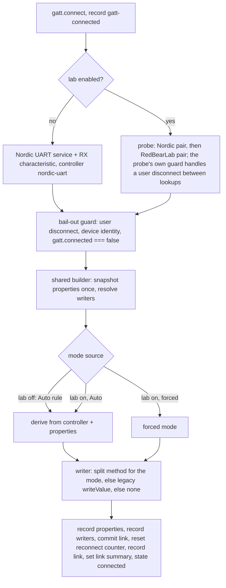

# Acknowledged Writes on the Default BLE Path - Plan

## Goal Capsule

- **Objective:** Make every user's Bluetooth path light the older official MoonBoard LED boxes: after the Nordic UART write characteristic resolves, read its properties once and write with response when they report plain write only, exactly as the admin BLE lab's Auto mode already does. Everything else on the default path stays as it is.
- **Authority:** The Product Contract below is fixed; the user confirmed scope and both call-outs on 2026-10-30 (one shared link builder for both paths; the `docs/solutions/` entry follows the post-merge gym check). `AGENTS.md` tier rules apply: `web/src/ble/**` and `shared/spec/ble-protocol.md` are safety-critical, so work is test-first, review before merge is mandatory, and effort is max. `docs/ble-hardware.md` invariants 1 to 5 must survive unchanged. The predecessor plan `docs/plans/2026-10-26-001-feat-web-ble-lab-plan.md` built the lab this plan promotes; its "Promoting the experimental path to the default" deferred item is what this plan delivers, for the Nordic half only.
- **Tier:** Safety-critical. Effort max.
- **Execution profile:** Implement on branch `feat/web-ble-ack-writes` in the worktree `.claude/worktrees/feat-web-ble-ack-writes`, based on `2ab2975` (the squash merge of PR #192). `web/.env` is already copied; `web/node_modules` is absent, so install dependencies first. Baseline: 1310 vitest tests green at `2ab2975`. Each unit lands as one commit with its suites green; tests precede code in every unit. The Vercel GitHub integration builds every push of the branch to a preview and deploys `main` to production, so merging is the production deploy.
- **Stop conditions:** Stop and report if the DIY Nordic board's write method would change for any properties other than plain-write-only; if the chooser request, the lookup set, or the lookup order on the default path would change; if the default path would honour any stored lab setting; if the `useBle` state shape or export set would have to change; if a toast would be added anywhere outside the lab; if a Bluefy behaviour can only be settled on hardware (record what the diagnostics would need and leave it to the owner's check). For the owner: no DIY board available for the preview check means no merge, because that check is the only catch for a browser that misreports the DIY characteristic; and a `mode=with-response` line for the DIY board in the production pre-check (lab on, Nordic only, Auto) stops the plan before the rule ships, since Bluefy would be reporting the DIY characteristic as plain write only. A dark gym box with the lab off after this ships is a finding to log, not a reason to add a mode flip.
- **Tail ownership:** The owner opens the preview built from the PR's head commit in Bluefy, confirms the DIY board lights with the lab off, records that commit beside the copied log, merges that commit (which ships), repeats the DIY check once on production after the installed app has picked up the new build, then lights a gym box with the lab off and pastes the copied diagnostics back. The `docs/solutions/` entry follows that gym check.

---

## Product Contract

### Summary

With the lab off, the client reads the Nordic write characteristic's properties once after it resolves and chooses the write type with the lab's existing Auto rule: acknowledged only when the box reports plain write and not write-without-response, unacknowledged otherwise, including when the browser hides the properties. Both paths build their link through one shared builder called from one place, so the rule cannot drift. The properties, the available write methods, and the chosen mode are recorded in the diagnostics on the default path too, and the default-path invariance suite is re-pinned to the new behaviour. The hardware doc and the protocol spec record what the gym box turned out to be.

### Problem Frame

On 2026-10-30 the owner lit a gym's older official MoonBoard LED box ("MoonBoard A") for the first time, through the admin BLE lab on an iPhone running Bluefy. The box is a Nordic UART controller whose write characteristic reports `write=true, writeWithoutResponse=false`. With the lab off, the Nordic-only chooser listed the box, the app connected, and the wall stayed dark, as at every visit since the first report, because the default path always calls `writeValueWithoutResponse` and CoreBluetooth drops that write silently when the characteristic lacks the write-without-response property while the browser still reports success. No log excerpt of that control run survives (the 100-event buffer had rolled by the time it was copied), so the control rests on the owner's observation. With acknowledged writes, about 45 sends over 77 minutes succeeded in roughly 50 to 220 ms, apart from three rejected after an idle gap (deferred below). The lab's Auto rule would have derived acknowledged writes for these properties; the owner had the mode forced to Acknowledged, so the rule itself was proven on hardware only by its inputs, and it is unit-tested.

The lab reaches one admin device. Everyone else at these gyms still gets a dark wall and a "lit" badge. The first attempt to fix this for everyone (PR #165) changed the chooser, added a second controller generation, and flipped modes at runtime, broke the owner's phone for both boards, and was reverted without a root cause. The lab exists so the second attempt could be observed; the gym observation is in, and the DIY board's properties as Bluefy reports them are gathered by the pre-check in the Verification Contract. The remaining change for everyone is one rule on one path, with the diagnostics already in place to read it back.

### Requirements

**Default-path write type**

- R1. After the Nordic UART RX characteristic resolves on the default path and the bail-out guard passes, the client snapshots `characteristic.properties` once, inside try/catch, and resolves which write methods the characteristic exposes, through the one link builder both paths share, called from a single place once either path has produced its characteristic and controller.
- R2. The mode is the lab's Nordic Auto rule: with-response only when the properties are present and report `write=true` and `writeWithoutResponse=false`; without-response in every other case, including absent properties, a throwing getter (folded into "absent"), both flags true, and neither flag set.
- R3. The default path never honours a stored lab write-mode override: the builder is handed the Auto rule, not the lab settings snapshot, while `enabled` is false, and the link records `forced=false`.
- R4. The writer is the split method for the mode; when that method is missing, legacy `writeValue`; when no write method exists, the link still commits and every send rejects at once with a readable message that keeps the "exposes no `<method>` method" phrase, suggests a supported browser, and does not mention the BLE lab; the generic "no write method" fallback text is likewise free of a lab reference. The rejection reaches users through the existing send-failure toast and the build screen's inline error, so no toast is added.
- R5. Unchanged on the default path: the chooser request is exactly `{ filters: [{ services: [NUS_SERVICE] }] }`; only the Nordic UART service and RX characteristic are looked up; the device `id` is never read; chunks stay at 20 bytes with the single same-mode retry after the existing beat; the connect timeout, retained-device reconnect, backoff, user-disconnect invariant, and echoed-disconnect rule are untouched; no toast is added anywhere; no localStorage key is written while the lab is off.
- R6. A reconnect re-derives the mode from the new characteristic; a live link never changes mode.

**Diagnostics**

- R7. The default path records `properties`, `writers`, and `link` events in the same format as the lab path, after the lookups and the bail-out guard, so a timed-out or user-disconnected attempt records none of them; the link summary carries the real snapshot. The `not read` and `not probed` markers and the `direct` writer kind are removed from the types, the formatters, the client, and every comment that describes the old path, including the lab settings module's.
- R8. Recording stays synchronous and guarded; persistence stays switched by the lab setting.

**Lab**

- R9. With the lab on, behaviour is unchanged: chooser modes, the Nordic-then-RedBearLab probe, forced modes, the legacy fallback, and the toasts; the lab-on suites pass with no assertion change. The lab's Auto mode on a Nordic link is the default path by construction.
- R10. The lab card no longer describes the off state as "today's Bluetooth behaviour" or introduces itself as the path for older boxes: the standard path reads the write type from the box and lights the older Nordic boxes; the lab adds the original box's controller type, the forced modes, and the log.

**Documentation**

- R11. `docs/ble-hardware.md` describes the default path's properties read and mode rule, lists the invariance suite's new pins and replaces "treat a red test there as a regression, not a test to update" with "change a pin only through a plan that names it", records the gym box facts scoped to the one unit observed (one official MoonBoard LED box installed at a gym, a Nordic UART controller advertising as "MoonBoard A" with a plain-write-only RX characteristic, lit by acknowledged writes in Bluefy on 2026-10-30, roughly 100 to 220 ms per two- or three-chunk send and about 50 ms for one chunk; other official boxes may differ), drops the `not read`/`not probed` wording from the diagnostics bullet, states that the lab-off log carries no `probe` lines, lives in memory only, and holds about 45 sends, and rewrites the Hardware status and Gotchas bullets so only the RedBearLab path remains unverified. UUIDs and the write-type rule stay in the spec; the hardware doc links.
- R12. `shared/spec/ble-protocol.md` states the write-type rule generically (the characteristic's properties decide; plain write only means write-with-response; the DIY Nordic boards are write-without-response), updates the chunking and flow-control section so the sequential await applies to either write type, documents the one official Nordic UART box observed as hardware-verified without generalising to every official box, and keeps the RedBearLab section marked unverified.
- R13. `web/CLAUDE.md`'s deploy section says that the Vercel GitHub integration builds every pushed branch to a preview and deploys `main` to production, so merging ships, names the Vercel dashboard rollback as the fast way back and the manual CLI deploy as the fallback, and notes that the installed PWA serves its cached shell for one load after a deploy. This is the one touch outside the BLE subsystem; the Verification Contract depends on it.

**Tests**

- R14. The default-path invariance suite is re-pinned as named in U1; the lab-off cases in the write-mode and discovery suites and the lab card's lab-off test follow in the same unit; the fake stack gains a throwing-properties option; acceptance-example markers in test comments name this plan where the predecessor's numbering would collide; the 22 pre-existing client tests in `web/src/ble/moonboard.test.ts` pass unchanged.

### Acceptance Examples

- AE1. **Gym box with the lab off.** Given the lab is off and the characteristic reports `write: true, writeWithoutResponse: false`, when a 45-byte problem is sent, then three chunks of 20, 20, and 5 bytes go through `writeValueWithResponse` in order, nothing goes through `writeValueWithoutResponse` or `writeValue`, and the `link` event reads `controller=nordic-uart mode=with-response forced=false writer=split`.
- AE2. **DIY board with the lab off.** Given the characteristic reports `writeWithoutResponse: true`, when a problem is sent, then every chunk goes through `writeValueWithoutResponse`, as today.
- AE3. **Thin shim with the lab off.** Given the characteristic exposes no `properties` and only `writeValueWithoutResponse`, when a problem is sent, then every chunk goes through `writeValueWithoutResponse`, the `properties` event reads `absent`, and the 22 pre-existing client tests pass unchanged. A properties getter that throws behaves the same and is still counted as one read.
- AE4. **A stale lab override is ignored.** Given the settings store holds `enabled: false, writeMode: 'with-response'` and the characteristic reports `writeWithoutResponse: true`, when a problem is sent, then chunks go without response and the link records `forced=false`; given `writeMode: 'without-response'` is stored and the characteristic reports plain write only, chunks go with response.
- AE5. **No write method.** Given the lab is off and the characteristic exposes no write method, when a problem is sent, then the send rejects at once with a message matching "exposes no writeValueWithoutResponse method", nothing is written, and the message does not match the BLE lab's name.
- AE6. **Lab-off log shape.** Given a fresh store, a successful lab-off connect, and one send, the diagnostics read, in order, `connect lab=off`, `device name=…`, `gatt-connected`, `properties …`, `writers …`, `link …`, `send …`, `send-ok …`, with no `probe` event.
- AE7. **Reconnect re-derives.** Given a lab-off link that derived with-response, when the link drops and the reconnect resolves a characteristic reporting `writeWithoutResponse: true`, then the new link writes without response and a write pending on the old link retries on the old characteristic only.
- AE8. **A severed attempt records no link.** Given the Nordic lookup hangs past the connect timeout, or a user disconnect lands while the lookup is pending and the lookup then resolves, then the properties getter is never read and no `properties` or `link` event is recorded.

### Scope Boundaries

- The iOS app is not changed.
- No RedBearLab lookup, no chooser change, and no runtime mode flip on the default path; a box that reports properties the rule does not flip on stays dark, visibly in the log, and the lab's forced mode is the workaround.
- No cross-mode fallback after a failed send: it would mask a browser that misreports properties, which the lab exists to diagnose.
- No per-device memory of the mode (it would need `device.id`, which the default path never reads) and no persistence of lab-off diagnostics.
- No change to how problems map to LEDs, to message letters, or to chunking.
- No deploy by the implementer; merging deploys, and the owner decides when to merge.

### Deferred to Follow-Up Work

- `docs/solutions/` entry for the write-type lesson, written with `/ce-compound` after the post-merge gym check confirms the default path lights the box.
- The idle-link episode from the 2026-10-30 log: after about nine minutes idle, three sends were rejected with Bluefy's bare code `2` with no disconnect event, a retained-device reconnect reported GATT connected in 9 ms and then hung at the Nordic lookup until the 10 s timeout, and a fresh chooser pick recovered. Recovery from a quietly dropped link is its own plan.
- The RedBearLab path stays lab-only and unverified on hardware.
- The open design call from PR #192: with the lab on and the Nordic-only picker on a non-Nordic board, the probe's RedBearLab lookup surfaces a `SecurityError` instead of the readable "no known MoonBoard LED service" message.
- Connect-failure toasts for everyone; serializing concurrent sends; the Bluefy late-commit race where a shim without `gatt.connected` lets a lookup that resolves after a reconnect timeout commit a link (pre-existing; after this plan it also logs `properties` and `link` after a `connect-timeout`).

---

## Planning Contract

### Key Technical Decisions

- KTD1. **One link builder, one call site.** The lab's builder becomes the builder for every connection and is renamed, since it is no longer lab-specific. Both branches of `establish` first produce a characteristic and a controller (the default branch from its Nordic-only lookup, the lab branch from the probe, which already returns that pair); then one bail-out check, one builder call, and one recording tail follow for both. Two call sites is how the `properties` and `writers` recording drifted into the lab branch today. The mode source is a parameter typed as the lab settings module's existing write-mode union (`auto` or a fixed mode); `forced` is simply "not auto". Rejected: a minimal change that derives the mode in `directLink` and calls the split method straight. It keeps two copies of the rule that can drift, and a shim lacking `writeValueWithResponse` would fail a plain-write-only box with a `TypeError` instead of the builder's legacy fallback or readable error. The cost is that the default path now also probes the three write methods with `typeof`; the lab already ran that code in Bluefy 3.9.3 on the gym box (`writers with+without+legacy`). The snapshot and the writer probe are synchronous, so no await separates the guard from the commit; the `phase` tracking, the shared in-flight promise, and the timeout's disconnect are untouched.
- KTD2. **The default path is handed the Auto rule, never the lab snapshot.** `setLabSettings` merges patches and the card's switch patches only `enabled`, so a device whose admin last chose Acknowledged keeps `writeMode: 'with-response'` in storage after the lab is switched off. Passing `this.lab` to the builder on the default path would force acknowledged writes for that device's default path. The default path passes the Auto rule as the mode source, and an invariance test sets a forced mode with the lab off through the settings store and proves it is ignored both ways (AE4).
- KTD3. **The asymmetric rule stays as the lab defined it.** Only `write=true, writeWithoutResponse=false` flips a Nordic link to acknowledged writes; absent properties keep today's unacknowledged mode because the DIY boards are write-without-response only and a thin shim that hides properties must not break them. A getter that throws folds into "absent" and is logged as such. The one case where a working board could misbehave is a browser that misreports the DIY characteristic as plain write only. The DIY firmware's RX characteristic is write-without-response only, so a misreport most likely has its acknowledged write rejected: the chunk retries once in the same mode, the send fails, and the user sees the send-failure toast. That is loud. The only silent outcome is a shim whose acknowledged write resolves without transmitting, and the owner's preview check on the DIY board is the gate for exactly that. A wrong unacknowledged write is silent at every layer, which is why the rule never guesses in that direction when the properties are plain.
- KTD4. **Diagnostics parity, and the lab-off markers go.** The default path records `properties`, `writers`, and `link` like the lab path, after the bail-out guard so a severed attempt leaves no phantom link. The `not read`, `not probed`, and `direct` values existed only to describe a path that no longer exists; removing them from `BleLinkSummary` and `BleWriter` narrows the types and deletes two dead formatter branches. The lab-off log has no `probe` lines because the default path does not probe; the hardware doc says so to keep a pasted log readable.
- KTD5. **The invariance suite is re-baselined by name.** `docs/ble-hardware.md` told readers never to update a red invariance test. That doctrine protected the lab-off path from drift while the fix was unproven; it now blocks the fix. The suite keeps every pin that still holds (chooser literal, lookups, no `id` read, no RedBearLab lookup, chunking, retry, no storage, surfaced chooser rejection) and changes exactly three: the properties read becomes "exactly once per connect", the write-method pin becomes "follows the properties" with one case per property combination, and the missing-method case becomes the builder's readable rejection. The doc wording becomes "change a pin only through a plan that names it".
- KTD6. **The missing-method message stops pointing at the lab, and keeps its shape.** Non-admins can now reach the builder's "no write method" rejection; its current text tells the user to change the write mode in the BLE lab. The reworded message keeps the "exposes no `<method>` method" phrase, which two lab-on tests assert, drops the lab reference, and suggests a supported browser. It surfaces through the existing send-failure toast in `useLightUp` and the build screen's inline error, so R5 holds.
- KTD7. **Hardware-verified wording for the Nordic box only.** The spec and the hardware doc record the gym box's facts as verified on 2026-10-30 in Bluefy, scoped to the one unit observed, state that the rule's input (the properties) and output (acknowledged writes light the box) were both observed, and keep every RedBearLab statement marked unverified. "MoonBoard A" is also the DIY firmware's default name, so the docs identify the unit by its installation, not its name. The `docs/solutions/` entry waits for the post-merge gym check so it records the default path lighting the box, not the lab.
- KTD8. **Verification order follows the deployment reality.** The Vercel GitHub integration deploys `main` to production, so the DIY board check happens on the preview built from the PR's head commit before merge, the merge of that commit is the production deploy, and the gym check follows. The preview's branch alias always serves the newest successful build, so the owner confirms the commit on the Vercel check or in the dashboard and any later push re-runs the gate. The owner reads results from the admin card's Copy diagnostics with the lab off. With the lab off the log lives in memory only, so the copy happens before leaving the page; switching the lab on afterwards would persist the buffer but overwrite whatever lab-on log the device still holds, so copy first. The installed PWA serves its cached shell for the first load after a deploy; the log is the build marker (the old build records no `properties` or `writers` events and `writer=direct`).

### High-Level Technical Design

Connection establishment after the change. The two paths meet at the shared builder; only the mode source differs.



The guard tests `gatt.connected === false`, not `!connected`, because the Bluefy shim may not implement the flag; a shim without it lets a lookup that resolves after a reconnect timeout commit a link (deferred, pre-existing).

Failure direction per board and reported properties, today and after this plan:

| Board | Properties reported | Today | After |
| --- | --- | --- | --- |
| DIY Nordic | `writeWithoutResponse: true` (alone or with `write`), absent, or neither flag | lights | lights, same method |
| DIY Nordic | plain write only (a browser misreport) | lights | acknowledged writes to a write-without-response-only characteristic: most likely rejected (`chunk-retry`, `send-failed`, toast, loud); silent only if a shim resolves without transmitting; the preview gate catches it |
| Official Nordic box (gym) | plain write only | Bluefy: silent dark; Chrome: likely a loud `NotSupportedError` | lights |
| Official Nordic box | absent, or both flags, or neither | dark | dark, but the log shows the properties; lab plus Acknowledged is the workaround |
| Official Nordic box | plain write only, shim lacks `writeValueWithResponse` | dark | legacy `writeValue`, or a readable send error |

### Sequencing

The owner's production pre-check (lab on, Nordic only, Auto, DIY board) runs as early as possible and may overlap U1; it must land before the preview gate. U1 (client, diagnostics types, fake stack, every affected suite) first; U2 (lab card copy and its helper-text assertions) after U1; U3 (docs) last, once the behaviour is pinned.

### Sources and Research

- The 2026-10-30 gym diagnostics (Appendix): the only hardware record of one official box's characteristic properties and of acknowledged writes lighting it.
- `docs/plans/2026-10-26-001-feat-web-ble-lab-plan.md`: KTD3 (one link record built two ways) and KTD4 (the asymmetric rule) are what this plan unifies and promotes; its Risks row 1 named the DIY-board regression surface this plan's preview gate covers.
- `web/src/ble/moonboard.ts`: `labLink`, `deriveWriteMode`, `snapshotProperties`, `availableWriters`, `directLink`, `establish`, `probe`, `bailedOut`, `write`, `writeChunk`; `web/src/ble/bleDiagnostics.ts`: `BleWriter`, `BleLinkSummary`, `formatProperties`, `formatWriters`, the 100-event cap and the persistence switch; `web/src/ble/labSettings.ts`: the write-mode union and the header comment that describes the old default path.
- `web/src/test/fakeBleStack.ts`: `properties`, `methods`, `minimal`, `reads` options; the reconnect idiom of a fresh stack returned from a re-mocked `gatt.connect`, and the held-lookup idiom, in `web/src/ble/moonboard.writeMode.test.ts` and `web/src/ble/moonboard.discovery.test.ts`.
- `web/src/ble/moonboard.test.ts`: the inline fake exposes only `writeValueWithoutResponse` and no `properties`, so its 22 tests stay valid under the rule (absent properties keep without-response).
- `web/vite.config.ts`: the PWA uses workbox `autoUpdate`, so an installed app serves the precached shell once after a deploy; the GitHub ruleset on `main` requires a pull request, so a git revert is a revert PR.
- Chromium `device/bluetooth/bluetooth_remote_gatt_characteristic_mac.mm` and boardsesh's MoonBoard protocol spec, both cited by the predecessor plan, for why the dark wall reports success and for the property test.
- Conventions: one squash commit per PR bundling source, tests, the hardware doc, the spec, and the plan; test files per concern over `bleHarness()`; sentence-style `it` names; `// Covers AEn.` markers; `for (... of [...] as const)` tables; no lint-disable comments exist in `web/src/ble`.

### System-Wide Impact

- **Shared BLE client.** Every consumer of `bleClient` (`useLightUp` on the problem detail and the last-opened bar, `BuildScreen`, the lab card) runs through the modified `establish`. `useBle`'s state shape and export set do not change; the six consumer test files that mock it with a closed export set stay valid.
- **Diagnostics types.** `BleLinkSummary.properties` and `.writers` lose their string markers and `BleWriter` loses `direct`; the only readers are `moonboard.ts`, the formatters, the lab card's status block (which already renders a snapshot), and the tests named in U1.
- **Bluefy users.** Every connect now reads the properties getter once and probes three method names with `typeof`; the lab did both in Bluefy 3.9.3 on the gym box. The DIY board on Bluefy has not been through the builder yet; the owner's production pre-check (lab on, Nordic only, Auto) is that observation, and the preview gate repeats it on the promoted path.
- **Firmware and hardware.** The bytes are unchanged; only the ATT write type differs, and only for a characteristic that reports plain write only.
- **Deployment.** Merging deploys production through the Vercel GitHub integration; the preview gate exists because of that. Installed PWAs pick the new build up on their second load; until then a user runs the old path, which is today's behaviour.
- **Storage.** Nothing new is written. A revert is storage-safe: the diagnostics key holds only timestamped event strings, the link summary is never persisted, and the lab settings key is untouched.

### Risks and Dependencies

| Risk | Mitigation |
| --- | --- |
| A browser misreports the DIY board's characteristic as plain write only | The DIY characteristic is write-without-response only, so the acknowledged write is most likely rejected and the failure is loud (`send-failed` and a toast); the only silent case is a shim that resolves without transmitting. The owner's preview check on the DIY board with the lab off is the merge gate; a `mode=with-response` line for the DIY board in the copied log is a revert trigger |
| Bluefy behaves differently for the properties getter or the `typeof` probes on the DIY board than it did on the gym box | Same shim, same code path as the lab run on 2026-10-30; absent or throwing properties resolve to today's mode; the preview gate observes the DIY case before merge |
| The preview's branch alias serves a build other than the commit the owner tested | The gate is pinned to the PR's head commit via the Vercel check or the dashboard; the commit is recorded beside the pasted log; any later push re-runs the gate |
| Merge ships to production without a manual step | The preview gate precedes merge by contract; U3 corrects the deploy doc; the fast rollback is Vercel's dashboard rollback to the `2ab2975` production deployment, followed by a code-only revert PR so the next merge does not re-ship |
| The installed PWA serves the old bundle on the first load after the deploy | Harmless (today's behaviour) and self-healing on the next load; the owner reloads until the lab card shows the new helper text and the log shows `properties` and `writers` events before the production check |
| A stale forced mode in a device's lab storage leaks into the default path | KTD2; AE4 pins it both ways; the owner's own device is the live case if its origin still holds a forced mode from the lab session |
| A plain-write-only box on a shim without `writeValueWithResponse` | Legacy `writeValue`, else a readable send error; today that box is silently dark, so every outcome is better |
| A box reports different properties on reconnect than on connect | Per-link derivation is the design (R6); the `link` lines show each derivation |
| The gym log rolls off before it is copied | The buffer holds 100 events, two per send; the owner clears the log, connects, lights one LED and one problem, and copies at once |
| The invariance suite's "never update" doctrine is now contradicted | KTD5 names each changed pin; the doc wording changes in the same PR |
| The gym box drops its link quietly after idling | Out of scope; recorded as a follow-up with the log evidence |

---

## Implementation Units

### U1. Shared link builder on both paths

**Goal:** The default path builds its link through the shared builder in Auto mode from a single call site, records what it found, and every suite that pinned the old path pins the new behaviour by name.

**Requirements:** R1 to R9, R14.

**Dependencies:** none.

**Files:**
- Modify `web/src/ble/moonboard.ts`
- Modify `web/src/ble/bleDiagnostics.ts`
- Modify `web/src/ble/labSettings.ts` (the `enabled` and `chooser` field comments that call the off state today's path, byte for byte)
- Modify `web/src/test/fakeBleStack.ts`
- Modify `web/src/ble/moonboard.invariance.test.ts`
- Modify `web/src/ble/moonboard.writeMode.test.ts`
- Modify `web/src/ble/moonboard.discovery.test.ts`
- Modify `web/src/shell/BleLabSection.test.tsx` (the lab-off connect test only)
- Keep `web/src/ble/moonboard.test.ts` unchanged

**Approach:** Restructure `establish` so both branches resolve a characteristic and controller, then one bail-out check, one call to the renamed builder, and one recording tail run for both (KTD1). The builder takes the mode source as the lab settings module's write-mode union; the default branch passes the Auto value, the lab branch the attempt's snapshot value. Remove `directLink`, the `'direct'` writer, the `'not read'` and `'not probed'` locals and markers, and the two string branches in the formatters; narrow `BleLinkSummary.properties` to the snapshot or null and `.writers` to the list or null. Reword the missing-method message per KTD6 and keep the generic fallback free of a lab reference. Update the module header, the `describeDevice` comment (the `id` is still lab-only), the lab settings module's field comments, and the fake stack's header so none claims the default path never reads properties; relabel `minimal` as the thin-shim shape; add a `properties: 'throws'` option whose getter increments the read counter and then throws. Acceptance-example markers: the invariance suite's header cites this plan and uses plain markers; the write-mode and discovery suites cite both plans and new markers carry the plan date, as in `// Covers AE7 (2026-10-30 plan).`

**Execution note:** Re-pin the invariance suite first and watch the inverted cases fail against the unmodified client; then make them pass. Keep every unchanged pin green throughout, and leave the lab-on suites untouched except for the markers.

**Patterns to follow:** `labLink`, `deriveWriteMode`, `probe`, and `establish` in `web/src/ble/moonboard.ts`; the reconnect idiom (fresh `fakeStack`, re-mocked `gatt.connect`) and the lab-off `describe` in `web/src/ble/moonboard.writeMode.test.ts`; the held-lookup idiom and the `for (... of [...] as const)` tables in `web/src/ble/moonboard.discovery.test.ts`; `bleHarness()` and `connectedClient(write, opts)` in `web/src/test/fakeBleStack.ts`.

**Test scenarios:**
- Invariance pins kept unchanged: chooser request deep-equals the Nordic literal with `filters` as its only key; `getPrimaryService` once with the Nordic UUID and `getCharacteristic` once with the RX UUID; `reads.id` stays 0; a three-chunk send is 20/20/5 in order; a transient first rejection yields exactly two calls in the same mode; no `localStorage.setItem` or `removeItem` from the Bluetooth path; a chooser rejection surfaces as itself and leaves the client disconnected.
- Changed pin: `reads.properties` is exactly 1 after a connect and a send, and 2 after one reconnect.
- Covers AE1. Changed pin, inverted, kept as its own named test: properties `write: true, writeWithoutResponse: false` yields three `writeValueWithResponse` calls and no `writeValueWithoutResponse` or `writeValue` call; `client.writeMode` is `with-response`; the `link` event reads `forced=false writer=split`.
- Covers AE2 and AE3. One table over the remaining combinations, in the `as const` idiom: `write: false, writeWithoutResponse: true`; both true; neither; `minimal`; `properties: 'throws'`. Each yields without-response chunks only, `reads.properties` 1, and the throwing and `minimal` rows record `properties absent`.
- Changed pin: with no write method the link commits, the send rejects without any write call or retry delay, and the message matches "exposes no writeValueWithoutResponse method" and does not match the lab's name; with only legacy `writeValue` the chunks go through it and the `link` event reads `writer=legacy`.
- Covers AE4. A forced `with-response` set through the settings store with the lab off, against a write-without-response characteristic, writes without response and records `forced=false`; a forced `without-response` against a plain-write-only characteristic writes with response. Separate tests from AE6, because the settings change records its own event.
- Covers AE6. From a fresh store, the event kinds of a lab-off connect and send are, in order, `connect`, `device`, `gatt-connected`, `properties`, `writers`, `link`, `send`, `send-ok`; no `probe` event is present; the `connect` detail is `lab=off`.
- Covers AE7. A lab-off link that derived with-response drops; the reconnect resolves a characteristic reporting `writeWithoutResponse: true`; the new link writes without response, and a pending acknowledged write on the old characteristic retries on the old characteristic only.
- Covers AE8, in the discovery suite beside its lab-on siblings. The Nordic lookup hangs past the timeout: `connect-timeout` is recorded, `reads.properties` is 0, and no `properties` or `link` event exists. The Nordic lookup is held, the user disconnects, and the lookup is then released with the service: the attempt resolves without error, `reads.properties` is 0, and no `properties` or `link` event exists.
- Write-mode suite, lab-off `describe`, reduced to the summary shape: a plain-write-only Nordic characteristic yields `writer` `split`, a present properties snapshot, and writers `with` and `without`.
- Discovery suite, the lab-off attempt that stays lab-off across a reconnect while the lab is switched on meanwhile: `getPrimaryService` is only ever called with the Nordic UUID across both connects, no `probe` event exists, `reads.id` is 0, and `reads.properties` is 2.
- Lab card, lab off with the thin-shim fake: `reads.properties` is 1 after the card connects and the Properties row reads `absent`.
- Lab card, lab off with a fake reporting plain write only: the status block shows `with-response`, and Light LED 0 reports "sent, 1 chunk, with-response".
- Lab-on suites unchanged and green: the probe, forced modes, legacy fallback, `lightLed`, the R25 bound, and the connect-failure diagnostics; the two missing-method assertions still match.
- The 22 tests in `web/src/ble/moonboard.test.ts` pass with no edit.

**Verification:** All BLE suites and the card suite pass; `npm run build` and `npm run lint` are clean; a search of `web/src` finds neither the quoted markers `'direct'`, `'not read'`, `'not probed'` nor the bare word `direct` in a BLE comment.

### U2. Lab card copy

**Goal:** The card describes the two paths truthfully now that both read the write type from the box.

**Requirements:** R10, R14.

**Dependencies:** U1.

**Files:**
- Modify `web/src/shell/BleLabSection.tsx`
- Modify `web/src/shell/BleLabSection.test.tsx` (new helper-text assertions in the options test)

**Approach:** Replace the card's intro sentence ("Experimental Bluetooth path for older MoonBoard LED boxes") with one that says the lab is for probing a board the standard path cannot light, and replace the switch helper ("Off = today's Bluetooth behaviour. On = pick both controller types and choose the write type from the box.") with a sentence pair: the standard path connects to Nordic boards and reads the write type from the box; the lab adds the original box's controller type and lets the admin force the write type. Leave the picker and write-mode helpers as they are. The card test asserts none of the replaced sentences today, so add assertions to its options test for the new intro and switch-helper sentences and for the absence of the old ones; the existing assertion on "Changing a setting disconnects the board" stays.

**Execution note:** Add the assertions first, then the copy; the component is otherwise unchanged.

**Patterns to follow:** The helper-text assertions in `web/src/shell/BleLabSection.test.tsx`; shadcn tokens per `web/CLAUDE.md`.

**Test scenarios:**
- The intro and the switch helper name the standard path's read-from-the-box behaviour and the lab's forced modes; the "today's Bluetooth behaviour" and "for older MoonBoard LED boxes" sentences are gone.
- Every existing card scenario (settings, quick actions, log, copy, clear, the connecting lock) stays green.

**Verification:** The card suite passes; the card renders at phone width without horizontal overflow (manual check).

### U3. Documentation

**Goal:** The docs describe the default path as it now is, record what the gym box turned out to be, and stop claiming that merging does not deploy.

**Requirements:** R11, R12, R13.

**Dependencies:** U1, U2.

**Files:**
- Modify `docs/ble-hardware.md`
- Modify `shared/spec/ble-protocol.md`
- Modify `web/CLAUDE.md`

**Approach:** In the hardware doc's "Web client" section, replace the sentences saying the properties and `id` are never read and chunks go through `writeValueWithoutResponse` with the new rule (properties read once after the lookups; mode from the lab's Auto rule; `id` still never read), list the pins the invariance suite now holds, and replace the "red test is a regression, not a test to update" sentence with the plan-names-the-pin rule. In the "BLE lab" section, state what the lab still adds (chooser modes, the RedBearLab probe, forced modes, the log), drop the `not read`/`not probed` wording from the Diagnostics bullet, note that the lab-off log carries no `probe` lines, lives in memory only, and holds about 45 sends, and rewrite the Hardware status bullet: the Nordic write-only box is verified (name, properties, acknowledged writes, send timings, date, browser); the RedBearLab path is not. In Gotchas, say the default path now writes with response to a plain-write-only characteristic and drop "route any new Bluetooth behaviour through the lab first" in favour of the plan rule. Keep UUIDs and the rule's definition in the spec and link to it. In the spec, rewrite the write-type rule as a generic rule under its own heading, rename and reword the chunking section so the sequential await covers either write type, add the official Nordic box as hardware-verified next to the still-unverified RedBearLab section, and leave the iOS flow-control text alone. In `web/CLAUDE.md`, replace the "no git-integration auto-deploy" paragraph with the integration's behaviour (preview per pushed branch, `main` to production), name the dashboard rollback as the fast way back, note the cached shell on the first load after a deploy, and keep the CLI steps as the manual fallback.

**Test expectation:** none, documentation only; verify by reading the diff against R11 to R13.

**Verification:** No doc still says the default path never reads properties or always writes without response; no doc claims the RedBearLab path is verified; the owner's email appears in no committed file; the spec, not the hardware doc, holds the rule and the UUIDs.

---

## Verification Contract

| Gate | Command or check (from `web/`) | Applies to |
| --- | --- | --- |
| Owner pre-check on production, now | On `www.boardhang.app` (already at `2ab2975`) in Bluefy: lab on, picker Nordic only, write mode Auto, DIY Nordic board: Light up lights the wall; Copy diagnostics and paste the `properties`, `writers`, and `link` lines into the Appendix. This runs the exact builder and rule U1 promotes, with zero code. Expected `writeWithoutResponse=true` (or `absent`) and `mode=without-response forced=false`. U1 may start in parallel; a `mode=with-response` line for the DIY board here is a stop condition | before the preview gate, owned by the owner |
| Unit and component tests | `npx vitest run` (baseline 1310 at `2ab2975`) | every unit; the re-pinned invariance suite stays green from U1 on |
| Type check and bundle | `npm run build` (`tsc -b` then Vite) | U1, U2 |
| Lint | `npm run lint` (oxlint; never Prettier in `web/`) | U1, U2 |
| Safety-critical review | `/ce-code-review` on the branch before the PR | whole branch |
| Owner preview gate, before merge | Open the preview from the Vercel check on the PR's head commit (or confirm in the Vercel dashboard that the newest deployment's commit is the head) in Bluefy, lab off, DIY Nordic board: Light up lights the wall; then Settings, BLE lab card, Copy diagnostics, before leaving the page. Pass: wall lit, header `Lab: enabled=false`, `properties … writeWithoutResponse=true` (or `absent`), `link … mode=without-response forced=false writer=split`, `send-ok`. Record the commit beside the pasted log; any later push re-runs the gate; merge that commit only | merge gate, owned by the owner |
| Merge is the production deploy | Squash-merge the gated commit; the GitHub integration deploys `main`. On `www.boardhang.app`, reload until the lab card shows the new helper text and the log shows `properties` and `writers` events (`writer=direct` means the cached old build), then repeat the DIY check once. If this device's storage still holds a forced mode from the lab session, this run is the live stale-override check: header `writeMode=with-response` with `link … forced=false mode=without-response` | post-merge, owned by the owner |
| Owner gym check | Lab off at the gym: Clear log, Connect, Light LED 0, light one problem, Copy diagnostics at once (the buffer holds about 45 sends). Pass: the box appears in the lab-off chooser and connects, wall lit, `properties write=true writeWithoutResponse=false`, `link … mode=with-response forced=false writer=split`, `send-ok` | tail, not a merge gate |

Revert triggers for the owner: the DIY board is dark with the lab off; the copied log shows `mode=with-response` for the DIY board; `send-failed` on the DIY board. Not revert triggers, but paste the log: a lit gym box with `properties absent` (the shim hid the properties this time); a lit gym box with `writer=legacy` (the fallback carried the writes); a dark gym box with `properties absent` (use the lab's Acknowledged mode and report); an acknowledged `send-failed` at the gym (the box rejected the write).

Rollback: first the Vercel dashboard's rollback to the production deployment built from `2ab2975` (seconds, works from the phone); then a code-only revert PR on `main`, which requires a pull request, so the next merge does not re-ship. Docs from R11 to R13 stay. Storage needs no cleanup.

---

## Definition of Done

- All three units landed as commits on `feat/web-ble-ack-writes`, each referencing this plan, each with its suites green.
- `npx vitest run`, `npm run build`, and `npm run lint` pass in `web/`; the 22 pre-existing client tests are unchanged and green.
- The invariance suite proves R2 to R5 and R7 with one case per property combination, the stale-override cases, the reconnect re-derivation, the lab-off log shape; the discovery suite holds the severed-attempt cases; the lab-on suites are unchanged apart from marker comments and green.
- No quoted `'direct'`, `'not read'`, or `'not probed'` marker remains in `web/src`, and no BLE comment uses the bare word `direct`; the missing-method messages do not match the BLE lab's name.
- Docs updated per R11 to R13; only the RedBearLab path is called unverified; the deploy doc describes the GitHub integration and the dashboard rollback.
- Safety-critical review run and its findings applied.
- No dead-end or experimental code from abandoned approaches remains in the diff.
- PR opened with what changed and why, the failure-direction table, the owner's preview gate pinned to the head commit, the production check with the build marker, the gym check with the expected log lines, the rollback path, the statement that merging deploys production, and the deferred list; no deploy performed by the implementer.

---

## Appendix

Condensed diagnostics from the owner's gym session on 2026-10-30 (iPhone, iOS 18.7, Bluefy 3.9.3; lab on, chooser `both`, write mode forced to `with-response`). The unit is the gym's installed official MoonBoard LED kit, identified by its installation, not by its name: "MoonBoard A" is also the DIY firmware's default advertised name. The box never lit with the lab off during the same visit.

```text
device name=MoonBoard A id=640FF3F4
probe nordic-uart ok
properties write=true writeWithoutResponse=false notify=false
writers with+without+legacy
link controller=nordic-uart mode=with-response forced=true writer=split
send bytes=40 chunks=2 mode=with-response writer=split
send-ok ms=107
send bytes=47 chunks=3 mode=with-response writer=split
send-ok ms=193
```

About 45 sends between 16:55 and 18:12 UTC, 48 to 216 ms each, all `send-ok` apart from three at 17:18: after about nine minutes idle, three sends failed with `chunk-retry number: 2` then `send-failed number: 2` and no `disconnected` event; a retained-device connect reported `gatt-connected` in 9 ms, then `connect-timeout pending=nordic-uart lookup`; switching the lab off and on and picking the device again recovered it.

The lab-off control run from the same visit (the box listed by the Nordic-only chooser, connected, wall dark) is not in the excerpt: the buffer holds 100 events and had rolled past it by the time the log was copied. It matches the reports since 2026-10-26 on production's Nordic-only chooser, which connected to these boxes and never lit them.

The DIY board's `properties`, `writers`, and `link` lines as Bluefy reports them belong here once the owner runs the pre-check in the Verification Contract.
